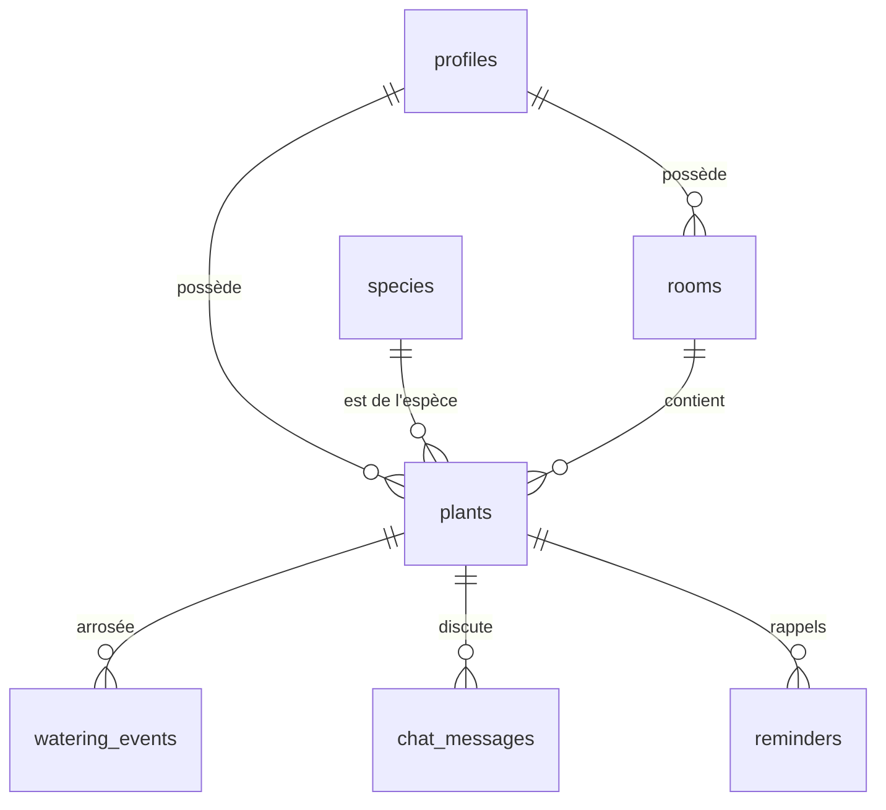

# 07 — Données & backend (Supabase)

## Vue d'ensemble
- **Supabase** : Auth (Google, Apple, OTP e-mail), Postgres + RLS, Storage (`plant-photos`, privé), Edge Functions (Deno) pour tout ce qui touche à l'IA ou aux secrets.
- Migration complète prête : `reference/supabase/schema.sql` → `supabase/migrations/0001_init.sql` (tables, trigger de création de profil + pièces, vue `plant_overview`, RLS, bucket, seed des 52 espèces).
- Types TS générés : `npx supabase gen types typescript --local > src/lib/database.types.ts`.

## Modèle

| Table | Champs clés |
|---|---|
| `profiles` | id (= auth.users.id), first_name, display_email, auth_provider, reminders_enabled, reminder_time, timezone, expo_push_token, onboarded_at |
| `rooms` | user_id, name, position (5 par défaut) |
| `species` | id texte, name, latin, form (type de dessin), category, color_a/b/f, light, light_label, air, water_every_days, tip — lecture publique |
| `plants` | user_id, species_id, nickname, room_id, light, water_every_days, species_source, photo_path, created_at (→ stade), archived_at |
| `watering_events` | user_id, plant_id, watered_at |
| `chat_messages` | user_id, plant_id, role, content, photo_path, actions (jsonb), created_at |
| `reminders` | user_id, plant_id, due_at, message, sent_at |
| vue `plant_overview` | plante + espèce + pièce + last_watered_at, days_since_water, days_since_created, is_thirsty (security_invoker → respecte la RLS) |

Le catalogue d'espèces existe **aussi** dans l'app (`reference/plants/species.ts`) pour l'affichage hors-ligne et les dessins. La table sert aux Edge Functions et à l'intégrité référentielle. Les deux doivent rester synchronisés (test qui compare les ids).

## Edge Functions
Secrets : `ANTHROPIC_API_KEY`, `CLAUDE_MODEL` (un modèle Claude récent avec vision, configurable), `SUPABASE_SERVICE_ROLE_KEY` (fonctions d'administration seulement).

### `identify-species` (POST, JWT requis)
> **Décision (30/10/2026)** : la reconnaissance utilise l'**API Pl@ntNet** (gratuite en usage non commercial, compte sur my.plantnet.org) et non Claude, pour une app personnelle sans coût. Secret `PLANTNET_API_KEY` ; la correspondance noms latins → catalogue (nom exact, synonymes reclassés, puis genre avec confiance plafonnée à 0.5) est dans `supabase/functions/_shared/matchSpecies.ts`. En local sans clé : `IDENTIFY_MOCK_SPECIES=<id>` dans `supabase/functions/.env`. Le texte ci-dessous décrit la version Claude d'origine, conservée pour mémoire.

Entrée `{ photoPath }`. Télécharge l'image depuis Storage (vérifie que le chemin commence par `auth.uid()`), appelle l'API Messages de Claude avec l'image (base64) et le prompt :
```
Tu identifies une plante d'intérieur à partir d'une photo.
Réponds UNIQUEMENT en JSON : {"speciesId": string|null, "confidence": number, "alternatives": string[]}.
speciesId doit être un id de cette liste, ou null si aucune ne correspond raisonnablement :
<liste id — nom — latin des 52 espèces>
confidence entre 0 et 1. alternatives : jusqu'à 2 autres ids plausibles.
```
Valide la sortie (id ∈ catalogue), renvoie `{ speciesId, confidence, alternatives }`. Timeout 20 s.

### `plant-chat` (POST, JWT requis)
> **Décision (30/10/2026)** : le chat utilise l'**API Gemini** (offre gratuite de Google) et non Claude, pour une app personnelle sans coût. Secrets `GEMINI_API_KEY`, `GEMINI_MODEL` (défaut `gemini-3.5-flash-lite`). Prompt, extraction de l'action et conversion de l'historique : `supabase/functions/_shared/chatPrompt.ts`. Les deux messages ne sont enregistrés qu'après la réponse (« Réessayer » ne duplique rien). En local sans clé : `CHAT_MOCK=1`. Sur l'offre gratuite, Google peut utiliser les échanges pour améliorer ses modèles.

Entrée `{ plantId, text?, photoPath? }`. Vérifie la propriété, quota (30/jour), charge le contexte depuis `plant_overview` + 20 derniers messages + 5 derniers arrosages, insère le message utilisateur, appelle Claude, insère et renvoie la réponse `{ id, content, actions }`.
Prompt système :
```
Tu es {nickname}, une plante ({species_name}, {latin}) qui vit dans le/la {room_name} de ton humain·e.
Tu parles à la première personne, en français, en tutoyant, avec chaleur et simplicité.
Ton état : dernier arrosage il y a {days_since_water} jours (rythme idéal : tous les {water_every_days} jours),
lumière à ton emplacement : {light}, lumière idéale : {light_label}, stade dans l'app : {stage}.
Réponds en 2 à 5 phrases, avec des conseils concrets et prudents. Si une photo est fournie, décris ce que tu observes avant de conseiller.
Ne prétends jamais être un professionnel ; en cas de doute sérieux (parasites étendus, pourriture), conseille de demander à un jardinier.
Mentionne la toxicité pour les animaux si c'est pertinent.
Si un suivi dans quelques jours est utile, termine par une ligne JSON seule :
{"action":{"type":"remind","days":N,"label":"Me rappeler dans N jours"}}
```
La fonction extrait la ligne JSON éventuelle vers `actions` et la retire du texte.

### `delete-account` (POST, JWT requis)
Supprime les objets Storage de l'utilisateur, puis `auth.admin.deleteUser(uid)` (cascade sur les tables).

### `daily-reminders` (v2, cron pg_cron toutes les 15 min)
Pour chaque profil dont l'heure locale de rappel tombe dans la fenêtre : calcule les plantes assoiffées, envoie un push Expo, marque `reminders.sent_at`.

## Stockage
Bucket privé `plant-photos`, chemins `{user_id}/{plant_id}/{uuid}.jpg` (et `{user_id}/tmp/…` avant création). Lecture par URL signée (1 h) mise en cache côté app.

## Accès aux données côté app (TanStack Query)
| Clé | Source |
|---|---|
| `['plants']` | `select * from plant_overview order by …` |
| `['plant', id]` | `plant_overview` filtré |
| `['chat', plantId]` | `chat_messages` par date |
| `['rooms']` | `rooms` par position |
| `['profile']` | `profiles` |
| Mutations | `water(plantId)`, `unwater(plantId)`, `createPlant(draft)`, `updatePlant(...)`, `deletePlant(id)`, `sendChat(...)`, `updateProfile(...)` — optimistes pour l'arrosage |
